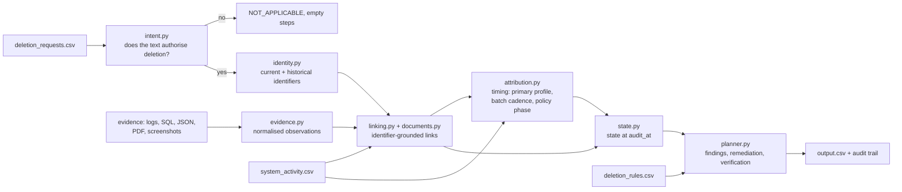

# Ghost Data Still Exists — deterministic deletion-audit agent

HackerRank Orchestrate (October 2026). For every request in `dataset/deletion_requests.csv`
the agent decides whether the deletion is `COMPLETE`, `INCOMPLETE` or `NOT_APPLICABLE`, and emits
the ordered findings → remediation → verification plan with the evidence that proves each
finding.

**Design choice: no LLM at inference time.** Every decision is a traceable function of the
supplied files: the same input always yields the same `output.csv`, every cited resource and
evidence id exists in the data, and nothing can be hallucinated. Screenshots are read with local
OCR (Tesseract, cached); PDFs with `pdftotext` / `pypdf`.

| set | status acc. | exact rows | step F1 | contract violations |
|---|---|---|---|---|
| public sample (32) | 100 % | 29/32 | 0.992 (precision 1.000) | — |
| custom scenarios (11) | 100 % | 11/11 | 1.000 | — |
| evaluation set (518) | hidden | hidden | hidden | **0** |

## Quick start

```bash
# from the repository root; Python 3.10+
pip install -r code/requirements.txt          # pillow, pypdf
python3 code/main.py                          # -> ./output.csv (518 rows, ~7 s)
python3 code/main.py --explain case_44        # reasoning trail for one case
python3 code/evaluation/main.py               # sample + custom metrics, contract check, usage report
python3 code/evaluation/ablation.py           # strategy comparison (~2 min)
python3 code/evaluation/consistency.py        # unsupervised check of the timing attribution
python3 -m unittest discover -s code/tests    # 57 tests
```

System tools: `tesseract` (only for the 11 screenshots) and `pdftotext` (poppler; `pypdf` is
the fallback). OCR text is cached in `code/.cache/`, so a machine without Tesseract still
reproduces the submitted output byte for byte. No network access, no API keys, no environment
variables are needed.

Outputs of a run: `output.csv` (submission), `code/evaluation/audit_trail.jsonl` (one JSON line
per case: intent, subject, primary profile, every linked resource with the reasons it was
linked, its category / state / evidence, and the steps) and `code/evaluation/run_stats.json`
(rendered into `usage_report.md`).

## Architecture



```
code/
├── main.py                     entry point: load → prepare (joint) → audit each case → output.csv
├── ghost_audit/
│   ├── config.py               feature switches + every tunable constant (windows, cadence, phases)
│   ├── logparse.py             one parser for 7 log layouts (bracket, pipe, logfmt, JSON, syslog, nested)
│   ├── evidence.py             file adapters -> Observation(resource, system, category, state,
│   │                           identifiers, time, evidence_id); SQL via sqlite3; PDF / OCR scan;
│   │                           complete-snapshot coverage
│   ├── identity.py             current + historical e-mails, phones, e-mail hashes, user_id
│   ├── intent.py               multilingual rule classifier: does the text authorise deletion?
│   ├── context.py              AuditData (loaded dataset) and CaseContext (per-request findings)
│   ├── linking.py              identifier links: observations, catalogue links, documents, lineage
│   ├── documents.py            grounded PDF / screenshot observations
│   ├── attribution.py          identifier-free records via workflow timing (joint over all requests)
│   ├── state.py                point-in-time state at audit_at, category resolution, omission
│   ├── policy.py               deletion_rules.csv -> required treatment; step vocabulary + order
│   ├── planner.py              states -> FINDING / REMEDIATION / VERIFICATION plan
│   ├── output.py               deterministic CSV / JSON serialisation
│   └── engine.py               Auditor: orchestrates the pipeline, produces the audit trail
├── evaluation/                 metrics, contract validator, custom scenarios, ablation,
│                               consistency check, generated reports
└── tests/                      unittest suite
```

### Pipeline

Steps 1–4 run once over all requests, because workflow events are shared between requests and
must be attributed jointly (one event is never given to two cases); steps 5–7 run per request.

1. **Intent** – erasure verbs in EN/ES/PT/FR/DE/IT/JA/KO/ZH vs. explicit refusals ("not asking
   for deletion", "keep the account active", "marketing lists only"). Refusals always win.
   Non-deletion → `NOT_APPLICABLE`, `[]`.
2. **Identity** – resolve the request e-mail (current *or* historical) to a `user_id` and collect
   every e-mail, phone, e-mail hash and the user id from `user_identities.csv` +
   `user_audit_log.csv`. Matching is exact (lower-cased e-mail, digits-only phone, SHA-256), so
   look-alike decoys such as `name.jr@…` are never attributed.
3. **Linking** – every artifact becomes observations *"at time T, file F saw resource R of
   system S in state X with identifiers I"* (snapshot bundles, service exports, lookup ledgers,
   hand-over notes, SQL primary / replica / reporting / failover tables, logs joined by trace id,
   PDFs, OCR'd screenshots). A resource belongs to the case if an observation carries one of the
   subject's identifiers, a `LINK_RESOURCE_IDENTITY` catalogue event names the subject, a document
   grounds it, or an active connector / restore re-populated it from a linked resource.
4. **Attribution of identifier-free records** – deleted profiles answer 404 without an e-mail and
   anonymised analytics have no identifiers, but the privacy workflow leaves a timing signature in
   `system_activity.csv`:
   * the primary profile is submitted 30–90 min before the reported status and the worker result
     mirrors it (`COMPLETE→SUCCESS`, `PARTIALLY_COMPLETE→PARTIAL`, `NOT_STARTED→FAILED`);
   * inside an audit batch consecutive requests advance that offset by a constant cadence, fitted
     per batch from the unambiguous cases and used to resolve ties;
   * follow-up "Policy action completed" events share the seconds phase of the case's primary
     submission (slot k: +40.5 s + 29.5 s·k), tying anonymised analytics and legal holds to
     exactly one case. Checked on events the model never used: 121/121 agree (chance: 14 %).
5. **State at `audit_at`** – only observations at or before `audit_at` and after the request
   count (retained records excepted); the latest wins, so stale reports and post-audit
   re-creations are both ignored. A complete snapshot from the case's own evidence batch that no
   longer lists a record proves it absent. Workflow results are claims, never states.
6. **Policy** – `deletion_rules.csv` maps each category to DELETE / REDACT / ANONYMIZE / RETAIN;
   data flows must be disabled and backups restore-blocked; tombstones keep the stable reference
   and lose direct identifiers. The worker's own operation (`DELETE_RECORD` vs `REDACT_RECORD` on
   a support item) disambiguates attachment vs. message.
7. **Planning** – findings, then remediation (disable flows → block restores → delete → redact →
   anonymise), then verification; within a phase by the operation table, then `system_id`,
   `resource_id`. Remediation and post-remediation checks cite `""`; `COMPLETE` verifications cite
   the in-time evidence that proves the state (files captured after `audit_at` are never cited).

## Design decisions and trade-offs

| decision | why | how we know it holds |
|---|---|---|
| No LLM at inference time; rules over normalised observations | every step must cite a real resource and evidence id; a generative model can invent ids, states or citations, and its output varies between runs | 0 contract violations; byte-identical output across runs, Python versions and a cold OCR run; $0 and 0 tokens per request |
| One observation model for every file family | logs, SQL replicas, bundles, ledgers, PDFs and screenshots all reduce to "time, resource, state, identifiers, evidence id", so state reasoning is written once | 7 log layouts and the JSON, text, log, SQL and screenshot adapters are covered by unit tests |
| Workflow results are claims, never states | the challenge's core trap: "Complete" while copies remain | statuses come only from evidence observed at or before `audit_at` |
| Timing attribution for identifier-free records, solved jointly | deleted profiles return 404 without an e-mail and anonymised analytics carry no identifiers; solving all requests of a status report together prevents one event being given to two cases | +0.31 exact rows on the sample (ablation); 121/121 held-out policy events agree vs 14 % chance |
| Absence by omission only from the case's own evidence batch | a complete snapshot proves absence, but only for the people it covers | applying it globally was measured as a regression (exact rows 0.906 → 0.625) and reverted |
| Every tuned constant lives in `config.py`; every technique has a switch | the timing constants are learnt from this dataset's workflow, so they must be visible and testable | ablation table; each technique has a custom scenario that only it solves |
| Explainability built in | an auditor must be able to defend every row | `--explain case_id` and `audit_trail.jsonl` list each linked resource with the reasons and evidence |

Where an LLM could be added safely: as an optional second opinion on request intent for
languages the rules do not cover, or on OCR text, with its answer accepted only when it names
an identifier that already exists in the evidence. No prompts are needed or shipped in this
version, because no model is called.

## Evaluation

See [`code/evaluation/evaluation_report.md`](code/evaluation/evaluation_report.md) (metrics,
custom cases, ablation, tests, failures and improvements) and
[`code/evaluation/usage_report.md`](code/evaluation/usage_report.md) (0 model calls, 0 tokens,
$0; run statistics of the final run).

The three non-exact sample rows reference resource ids that appear nowhere in the participant
data (e.g. `audit_record_6645`), so they are not recoverable from evidence.

## Notes

* `output.csv` at the repository root is the submission file.
* Only participant-facing files under `dataset/` are read. The public sample answers are used
  only by the evaluation workflow, never by the agent; no case id or expected answer is encoded.
